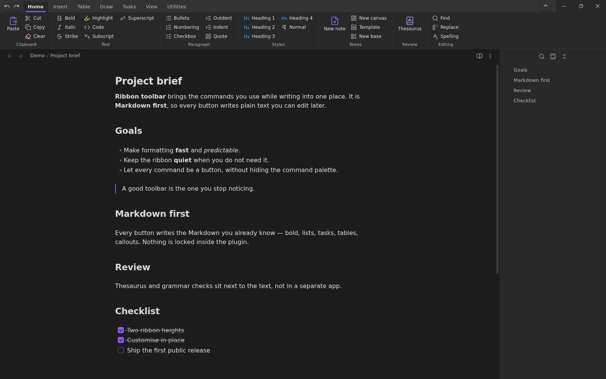
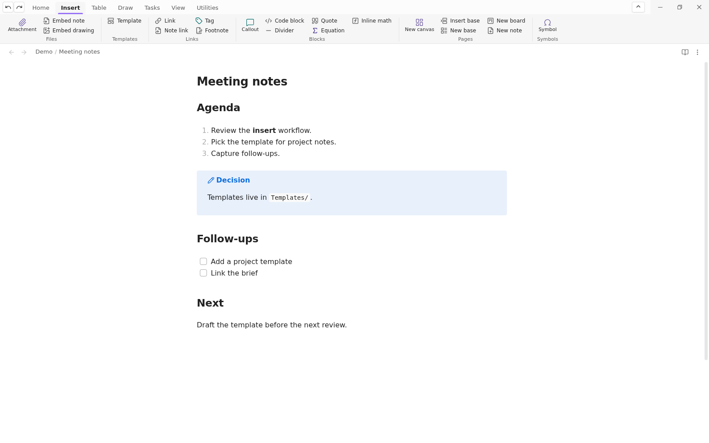
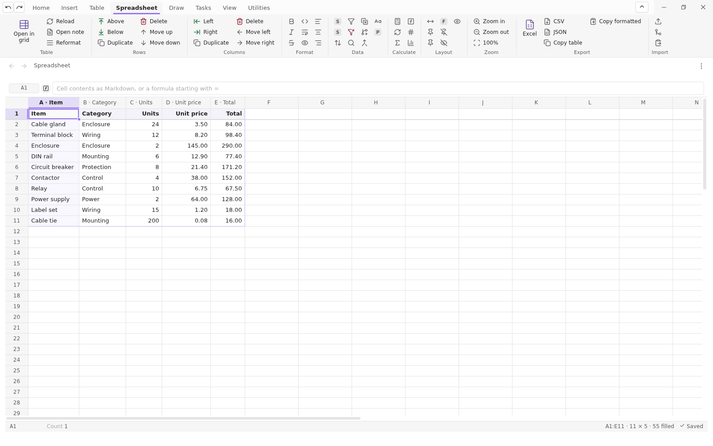
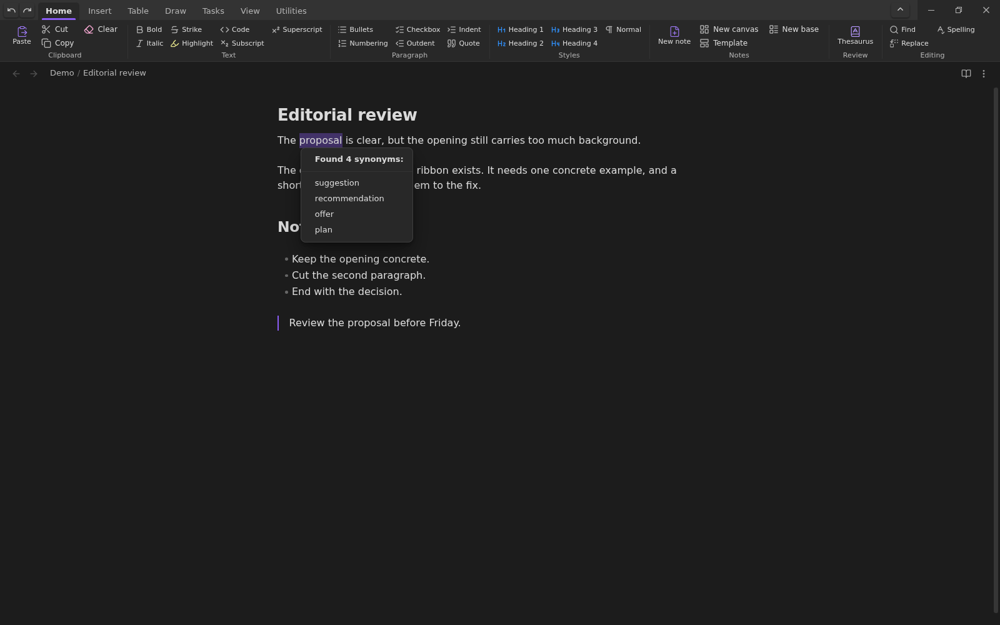
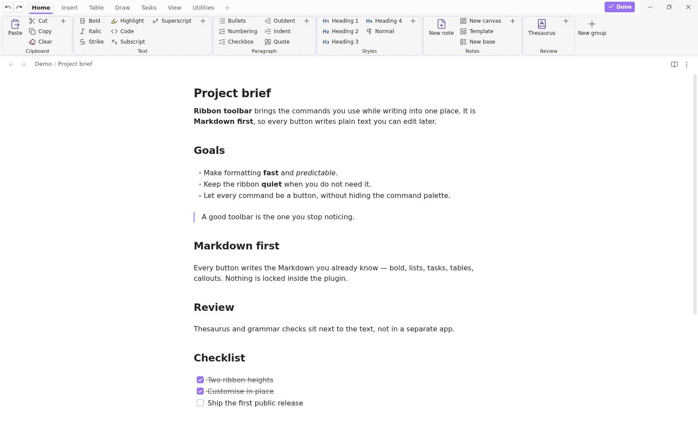

# Ribbon toolbar

An Office-style ribbon above the Obsidian workspace: tabs, labelled groups and buttons that
run commands. Inspired by [OneNote Style](https://github.com/Sundowna/obsidian-onenote-style),
but deliberately smaller — Markdown formatting only, no OneNote tags, page colours, subpages or
AI integrations.



## What it does

- **Two heights.** `Compact` is two rows of buttons (66 px of ribbon, a third shorter than the
  full one); `Full` is three rows (96 px) like the ribbon in OneNote Style. Both keep labels.
- **Everything is a command.** Any command from Obsidian, its core plugins or a community plugin
  can be put on the ribbon. Buttons whose command is unavailable are greyed out with the reason,
  and tabs that only make sense with an optional plugin (`Tasks`, `Git`, `Excalidraw`, `Templater`,
  `Spreadsheets`) are hidden until that plugin is installed.
- **Customise in place.** Right-click a tab, group or button to rename it, change its icon or
  colour, move it, or remove it. Customise mode adds drag and drop and `+` tiles. The layout can
  be exported to a JSON file and imported again.
- **Markdown only.** Bold, italic, strike, highlight, code, comments, headings, lists, quotes,
  checkboxes, links, tables, callouts, math, sub- and superscript. Subscript and superscript are
  the one exception: Markdown has no syntax for them, so they use `<sub>`/`<sup>`.
- **One place per action.** The default layout carries every command once: creating things lives
  in `Insert → Pages`, Excalidraw actions live on `Draw`, spreadsheet actions on the
  spreadsheet tabs.
  A test fails the build if a command appears twice.
- **Embeds, including canvases.** `Insert → Embed` opens the picker for any file; `Embed canvas`
  lists only canvases and inserts `![[drawing.canvas]]`.
- **Find a symbol by name.** Insert symbol opens a searchable palette of more than 200 characters —
  Greek letters, maths, units, arrows, currency, typography, marks and powers. Type what you mean
  (`ohm`, `omega`, `odpor`, `sipka`, `mikro`) and it ranks the character; Enter inserts the first
  hit, arrow keys walk the grid.
- **HTML formatting is opt-in.** Underline, font colour and a coloured highlight are inline HTML.
  They are off by default, their commands stay out of the command palette, and the `HTML` tab is
  hidden until the setting is turned on.
- **Starts collapsed if you want.** The ribbon can open as a tab row only; clicking a tab unfolds
  it, double-clicking a tab toggles it, and there is a command for it too.

## Screenshots

**Home — formatting, styles and review**


**Insert — the compact two-row ribbon: templates, links, blocks and pages**


**Spreadsheet — Markdown Spreadsheets' five tabs replace the ribbon while a grid is open**


**Review — thesaurus for the selected word, via the Synonym plugin**


**Customise — drag and drop, plus tiles and a Done button**


## Integrations

| Plugin | What the ribbon offers |
|---|---|
| **Markdown Spreadsheets** | Its whole Excel-style toolbar as five tabs — `Home`, `Data`, `Calculate`, `Table`, `Export` — which replace the normal tabs while a grid is open, the same way that plugin's own ribbon works. Closing the grid returns the ribbon to the tab you came from. While Ribbon toolbar is running, that plugin hides its own toolbar. Requires Markdown Spreadsheets **0.14.0**; older versions keep their own ribbon, so both bars would show, and the clipboard/history buttons need 0.14.0. |
| **Tasks** | Create/edit a task and toggle it done, next to Obsidian's own checkbox command. |
| **Templates** | Insert a template from the core Templates plugin. |
| **Templater** | Insert a Templater template, or start a new note from one. The buttons only appear when Templater is enabled. |
| **Excalidraw** | New drawing, embed a drawing, open one, toggle drawing/text. |
| **Canvas** | Jump to a group, convert to a note, export as an image. A new canvas is created from `Insert → Pages`. |
| **Bases** | New base, insert a base, add a view or an item. |
| **Synonym** | Thesaurus: synonym lookup for the selected word, using that plugin's local or online sources. |
| **LanguageTool** | Check text (whole note or selection) and clear its suggestion underlines. |
| **Advanced Tables** | Format the table at the cursor. |
| **Kanban** | New board, next to New canvas and New base. |
| **Obsidian Git** | A dedicated `Git` tab: commit and sync, pull, push, commit all, source control, history and fetch. |
| **Advanced PDF Export** | Opens its export panel from Utilities → File, next to the core Export PDF button. |

Every integration is detected from its plugin id or its command. If the plugin is missing or
turned off, its buttons — and a tab or group left with no buttons — are hidden rather than shown
greyed out.

The Markdown Spreadsheets integration is a duck-typed, versioned contract (`ribbonHostApi`), so
either plugin can be installed without the other. If Ribbon toolbar is disabled, the spreadsheet
plugin puts its own toolbar back. Use Markdown Spreadsheets **0.11.0 or newer**: that is the first
release that looks for the host API and hides its own toolbar.

## Install

Not in the community catalogue yet. Use [BRAT](https://github.com/TfTHacker/obsidian42-brat)
with `ondreu/ribbon-toolbar`, or copy `main.js`, `manifest.json` and `styles.css` from a release
into `<vault>/.obsidian/plugins/ribbon-toolbar/` and enable the plugin.

Desktop only: the bar is mounted above the workspace, where the mobile layout has no room for it.

## Settings

- **Ribbon height** — compact (two rows) or full (three rows).
- **Start collapsed** — show only the tab row at launch.
- **HTML formatting** — underline, font colour and coloured highlight.
- **Markdown spreadsheets** — let this ribbon host that plugin's toolbar. Its five tabs then
  replace the ribbon while a grid is open; turn this off to keep them beside the normal tabs.
- **Customise** — start customise mode, or reset the layout.

## Development

```bash
npm install
npm run check          # typecheck, lint, tests, production build
npm run build          # main.js
npm run harness        # dev render harness in tools/screenshots
```

The ribbon is data (`src/model/layout.ts`), sizing (`src/model/fit.ts`) and a renderer
(`src/view/RibbonView.ts`). Formatting edits are pure functions in `src/format/`, so they run
under vitest without Obsidian. `src/internal.ts` is the only file that touches undocumented
Obsidian APIs. `tools/screenshots/page.html` renders the real view with the real stylesheet in a
browser — `height=full|compact`, `theme=dark|light`, `tab=<id>`, `editing=1`, `collapsed=1` — which
is how the layout is checked at 1400, 900 and 760 px before a vault test.

The release tag must equal `manifest.json` character for character, with no `v` prefix:

```bash
node scripts/bump-version.mjs 0.2.7
npm run check
git commit -am "Release 0.2.7" && git push
git tag 0.2.7 && git push origin 0.2.7
```

## Privacy

No network access and no telemetry. **Paste** reads the system clipboard only when you press it;
**Copy** and **Cut** write to it only when you press them. The layout and settings stay in this
vault's plugin data (`data.json`).

## Credits

The ribbon model and the Office-like sizing ladder were inspired by
[Sundowna/obsidian-onenote-style](https://github.com/Sundowna/obsidian-onenote-style) (MIT).
Icons are [Lucide](https://lucide.dev) via Obsidian's icon set.

## License

MIT — see [LICENSE](LICENSE).
